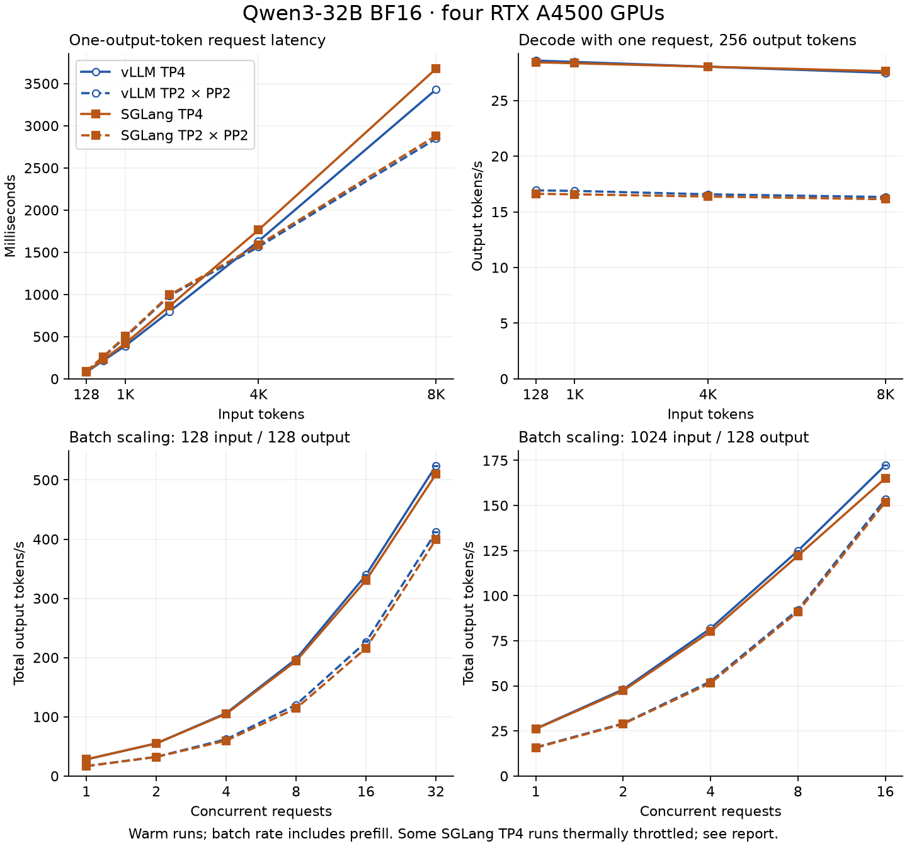
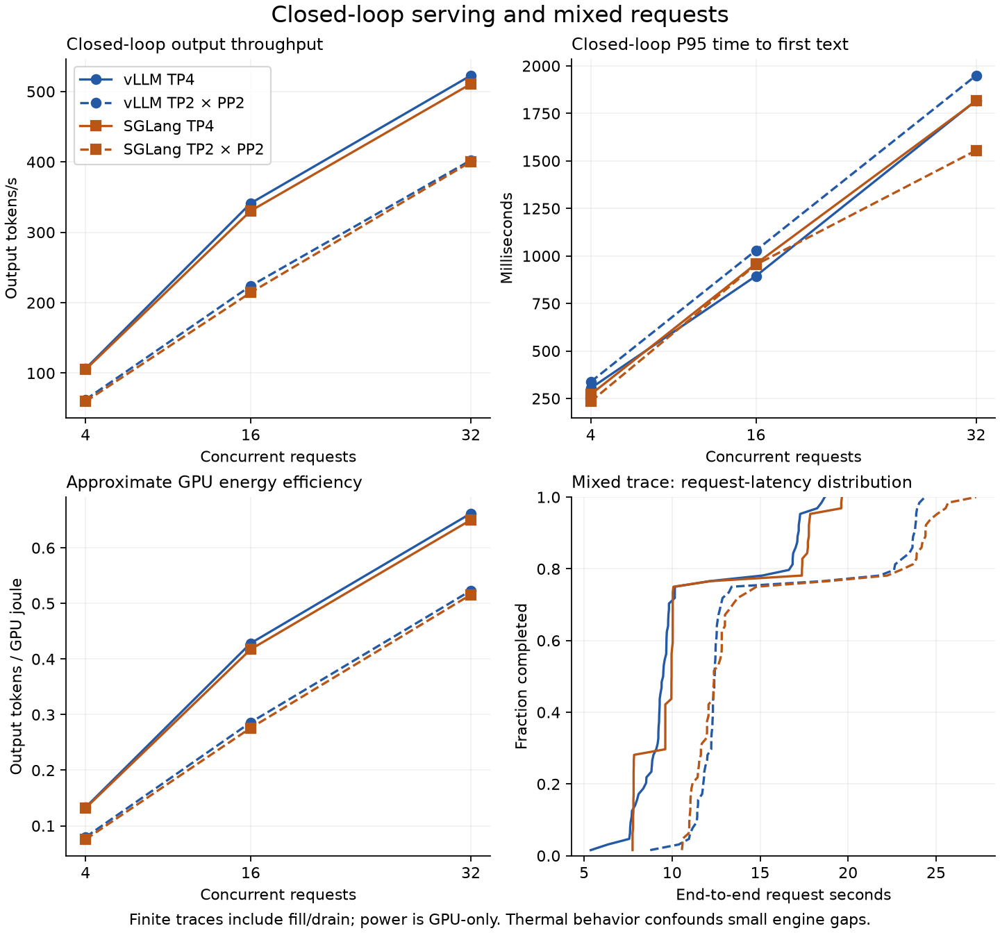
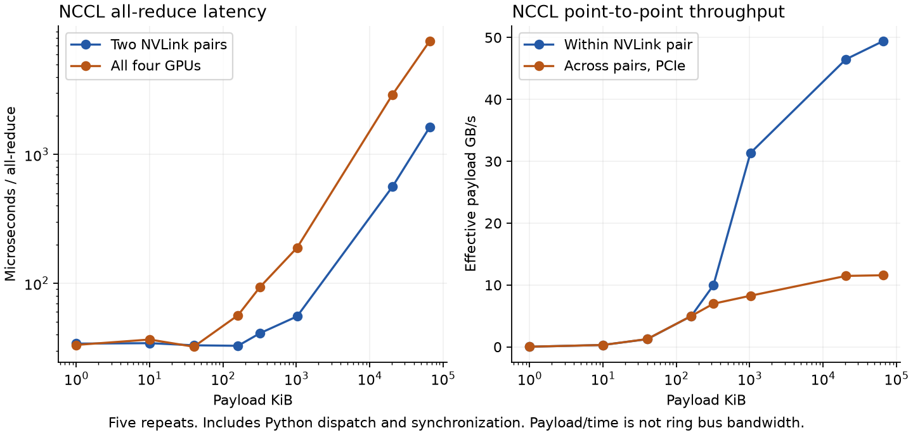
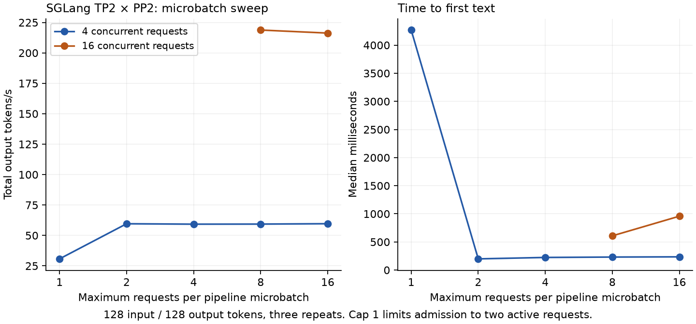

# Expanded Qwen3-32B BF16 measurements

Main matrix: 116 validated cases, 364 measured trials/traces, and 2992 requests. The pipeline microbatch section adds seven cases and 156 requests when complete.
Model revision `9216db5781bf21249d130ec9da846c4624c16137`. Corpus SHA256 `3ab8e3255afac657b33846e81ad497580c56ecbffd0aca32276802fcf2e24a96`.

Four RTX A4500 GPUs. Two NVLink pairs, PCIe between pairs. Context cap 9216, running-request cap 32, prefill chunk/budget 2048, memory fraction 0.88. Prefix reuse and speculation disabled. See [methodology](../EXTENDED.md) for the full configuration and timing definitions.

For initial engine work, compare context_decode and long_decode for one-request execution, prefill_probe for prompt processing, batch_short/batch_1k for batching, and closed_loop/mixed for scheduling. GPU memory is a separate allocation baseline.

Decode rate uses a single request where concurrency is 1. Output throughput includes prefill and client overhead. Prefill-probe input throughput includes one output token and a nonstreaming HTTP response. P95 values are descriptive and require at least 20 observed requests. Closed-loop traces include filling and draining.

Some SGLang TP4 cases reported thermal slowdown during this sustained session. Small differences between engine implementations are confounded by temperature and clock behavior. Thermal-reason logging started after the vLLM throughput runs, so their absence of flags is unverified. The CSV records per-case sensor coverage and thermal samples; all configurations have clock and temperature samples.

## Findings

- Single request, 1024 input/256 output: vLLM TP4 28.5 decode tok/s, TP2 × PP2 16.9; SGLang 28.3 and 16.6.
- Continuous 32-client short requests: vLLM TP4 522.8 total output tok/s; SGLang TP4 510.8. The pipeline layouts deliver about 400 tok/s.
- 8192-input/1-output prompt probe: vLLM TP2 × PP2 2.85 s, TP4 3.43 s. The pipeline layout wins this prefill-heavy case.
- Both engines schedule overlapping pipeline work. TP4 winning batched decode does not imply that the pipeline implementation simply leaves one pair idle. Smaller microbatches, local matrix shapes and weight reuse, communication, and scheduling all affect the tradeoff.
- The similar overall engine results do not establish a small implementation advantage: sequential test order and recorded thermal slowdown confound percent-level differences.

## prefill probe

| Engine/layout | Input | Output | C | Requests | Output tok/s | TTFT ms | Decode tok/s/request | P95 E2E s |
|---|---:|---:|---:|---:|---:|---:|---:|---:|
| vllm-tp4-pp1 | 128 | 1 | 1 | 5 | 12.67 | - | - | - |
| vllm-tp4-pp1 | 512 | 1 | 1 | 5 | 4.66 | - | - | - |
| vllm-tp4-pp1 | 1024 | 1 | 1 | 5 | 2.56 | - | - | - |
| vllm-tp4-pp1 | 2048 | 1 | 1 | 5 | 1.25 | - | - | - |
| vllm-tp4-pp1 | 4096 | 1 | 1 | 5 | 0.61 | - | - | - |
| vllm-tp4-pp1 | 8192 | 1 | 1 | 5 | 0.29 | - | - | - |
| vllm-tp2-pp2 | 128 | 1 | 1 | 5 | 11.43 | - | - | - |
| vllm-tp2-pp2 | 512 | 1 | 1 | 5 | 3.89 | - | - | - |
| vllm-tp2-pp2 | 1024 | 1 | 1 | 5 | 2.03 | - | - | - |
| vllm-tp2-pp2 | 2048 | 1 | 1 | 5 | 1.02 | - | - | - |
| vllm-tp2-pp2 | 4096 | 1 | 1 | 5 | 0.64 | - | - | - |
| vllm-tp2-pp2 | 8192 | 1 | 1 | 5 | 0.35 | - | - | - |
| sglang-tp4-pp1 | 128 | 1 | 1 | 5 | 11.98 | - | - | - |
| sglang-tp4-pp1 | 512 | 1 | 1 | 5 | 4.40 | - | - | - |
| sglang-tp4-pp1 | 1024 | 1 | 1 | 5 | 2.38 | - | - | - |
| sglang-tp4-pp1 | 2048 | 1 | 1 | 5 | 1.16 | - | - | - |
| sglang-tp4-pp1 | 4096 | 1 | 1 | 5 | 0.57 | - | - | - |
| sglang-tp4-pp1 | 8192 | 1 | 1 | 5 | 0.27 | - | - | - |
| sglang-tp2-pp2 | 128 | 1 | 1 | 5 | 11.13 | - | - | - |
| sglang-tp2-pp2 | 512 | 1 | 1 | 5 | 3.82 | - | - | - |
| sglang-tp2-pp2 | 1024 | 1 | 1 | 5 | 1.99 | - | - | - |
| sglang-tp2-pp2 | 2048 | 1 | 1 | 5 | 1.01 | - | - | - |
| sglang-tp2-pp2 | 4096 | 1 | 1 | 5 | 0.63 | - | - | - |
| sglang-tp2-pp2 | 8192 | 1 | 1 | 5 | 0.35 | - | - | - |

| Engine/layout | Input tokens | One-token request latency ms | Effective input tok/s |
|---|---:|---:|---:|
| vllm-tp4-pp1 | 128 | 78.91 | 1622.06 |
| vllm-tp4-pp1 | 512 | 214.73 | 2384.41 |
| vllm-tp4-pp1 | 1024 | 390.43 | 2622.72 |
| vllm-tp4-pp1 | 2048 | 798.73 | 2564.06 |
| vllm-tp4-pp1 | 4096 | 1631.04 | 2511.28 |
| vllm-tp4-pp1 | 8192 | 3428.21 | 2389.58 |
| vllm-tp2-pp2 | 128 | 87.49 | 1462.98 |
| vllm-tp2-pp2 | 512 | 256.77 | 1994.00 |
| vllm-tp2-pp2 | 1024 | 491.63 | 2082.87 |
| vllm-tp2-pp2 | 2048 | 985.10 | 2078.99 |
| vllm-tp2-pp2 | 4096 | 1562.29 | 2621.79 |
| vllm-tp2-pp2 | 8192 | 2845.28 | 2879.15 |
| sglang-tp4-pp1 | 128 | 83.44 | 1534.01 |
| sglang-tp4-pp1 | 512 | 227.48 | 2250.78 |
| sglang-tp4-pp1 | 1024 | 419.37 | 2441.76 |
| sglang-tp4-pp1 | 2048 | 863.48 | 2371.79 |
| sglang-tp4-pp1 | 4096 | 1763.76 | 2322.32 |
| sglang-tp4-pp1 | 8192 | 3674.53 | 2229.40 |
| sglang-tp2-pp2 | 128 | 89.86 | 1424.52 |
| sglang-tp2-pp2 | 512 | 261.57 | 1957.44 |
| sglang-tp2-pp2 | 1024 | 502.60 | 2037.40 |
| sglang-tp2-pp2 | 2048 | 994.80 | 2058.71 |
| sglang-tp2-pp2 | 4096 | 1587.46 | 2580.23 |
| sglang-tp2-pp2 | 8192 | 2880.24 | 2844.21 |

## context decode

| Engine/layout | Input | Output | C | Requests | Output tok/s | TTFT ms | Decode tok/s/request | P95 E2E s |
|---|---:|---:|---:|---:|---:|---:|---:|---:|
| vllm-tp4-pp1 | 128 | 256 | 1 | 3 | 28.44 | 79.12 | 28.59 | - |
| vllm-tp4-pp1 | 1024 | 256 | 1 | 3 | 27.35 | 401.21 | 28.47 | - |
| vllm-tp4-pp1 | 4096 | 256 | 1 | 3 | 23.77 | 1672.62 | 28.04 | - |
| vllm-tp4-pp1 | 8192 | 256 | 1 | 3 | 20.03 | 3501.05 | 27.49 | - |
| vllm-tp2-pp2 | 128 | 256 | 1 | 3 | 16.89 | 88.45 | 16.93 | - |
| vllm-tp2-pp2 | 1024 | 256 | 1 | 3 | 16.39 | 512.63 | 16.88 | - |
| vllm-tp2-pp2 | 4096 | 256 | 1 | 3 | 15.04 | 1636.91 | 16.57 | - |
| vllm-tp2-pp2 | 8192 | 256 | 1 | 3 | 13.78 | 2965.05 | 16.33 | - |
| sglang-tp4-pp1 | 128 | 256 | 1 | 3 | 28.28 | 85.11 | 28.43 | - |
| sglang-tp4-pp1 | 1024 | 256 | 1 | 3 | 27.16 | 429.51 | 28.35 | - |
| sglang-tp4-pp1 | 4096 | 256 | 1 | 3 | 23.51 | 1796.14 | 28.04 | - |
| sglang-tp4-pp1 | 8192 | 256 | 1 | 3 | 19.77 | 3717.65 | 27.63 | - |
| sglang-tp2-pp2 | 128 | 256 | 1 | 3 | 16.59 | 90.54 | 16.62 | - |
| sglang-tp2-pp2 | 1024 | 256 | 1 | 3 | 16.09 | 523.58 | 16.58 | - |
| sglang-tp2-pp2 | 4096 | 256 | 1 | 3 | 14.87 | 1639.84 | 16.38 | - |
| sglang-tp2-pp2 | 8192 | 256 | 1 | 3 | 13.66 | 2939.57 | 16.14 | - |

## long decode

| Engine/layout | Input | Output | C | Requests | Output tok/s | TTFT ms | Decode tok/s/request | P95 E2E s |
|---|---:|---:|---:|---:|---:|---:|---:|---:|
| vllm-tp4-pp1 | 128 | 1024 | 1 | 3 | 28.36 | 79.43 | 28.40 | - |
| vllm-tp2-pp2 | 128 | 1024 | 1 | 3 | 16.88 | 88.94 | 16.89 | - |
| sglang-tp4-pp1 | 128 | 1024 | 1 | 3 | 28.33 | 85.33 | 28.37 | - |
| sglang-tp2-pp2 | 128 | 1024 | 1 | 3 | 16.59 | 90.70 | 16.60 | - |

## batch short

| Engine/layout | Input | Output | C | Requests | Output tok/s | TTFT ms | Decode tok/s/request | P95 E2E s |
|---|---:|---:|---:|---:|---:|---:|---:|---:|
| vllm-tp4-pp1 | 128 | 128 | 1 | 3 | 28.14 | 79.49 | 28.42 | - |
| vllm-tp4-pp1 | 128 | 128 | 2 | 6 | 54.98 | 126.25 | 28.15 | - |
| vllm-tp4-pp1 | 128 | 128 | 4 | 12 | 106.15 | 306.88 | 28.12 | - |
| vllm-tp4-pp1 | 128 | 128 | 8 | 24 | 197.57 | 484.48 | 27.04 | 5.21 |
| vllm-tp4-pp1 | 128 | 128 | 16 | 48 | 339.45 | 912.44 | 24.82 | 6.03 |
| vllm-tp4-pp1 | 128 | 128 | 32 | 96 | 523.83 | 981.21 | 18.67 | 7.82 |
| vllm-tp2-pp2 | 128 | 128 | 1 | 3 | 16.84 | 89.13 | 16.90 | - |
| vllm-tp2-pp2 | 128 | 128 | 2 | 6 | 32.34 | 113.40 | 16.32 | - |
| vllm-tp2-pp2 | 128 | 128 | 4 | 12 | 62.02 | 338.76 | 16.04 | - |
| vllm-tp2-pp2 | 128 | 128 | 8 | 24 | 120.32 | 481.97 | 15.88 | 8.57 |
| vllm-tp2-pp2 | 128 | 128 | 16 | 48 | 226.39 | 860.00 | 15.61 | 9.07 |
| vllm-tp2-pp2 | 128 | 128 | 32 | 96 | 411.91 | 1307.92 | 14.75 | 9.95 |
| sglang-tp4-pp1 | 128 | 128 | 1 | 3 | 28.09 | 85.05 | 28.40 | - |
| sglang-tp4-pp1 | 128 | 128 | 2 | 6 | 55.08 | 149.49 | 28.15 | - |
| sglang-tp4-pp1 | 128 | 128 | 4 | 12 | 104.99 | 233.59 | 27.38 | - |
| sglang-tp4-pp1 | 128 | 128 | 8 | 24 | 194.19 | 478.57 | 26.49 | 5.32 |
| sglang-tp4-pp1 | 128 | 128 | 16 | 48 | 330.52 | 951.35 | 24.23 | 6.20 |
| sglang-tp4-pp1 | 128 | 128 | 32 | 96 | 509.72 | 1174.31 | 18.54 | 8.04 |
| sglang-tp2-pp2 | 128 | 128 | 1 | 3 | 16.55 | 91.03 | 16.62 | - |
| sglang-tp2-pp2 | 128 | 128 | 2 | 6 | 32.18 | 151.97 | 16.28 | - |
| sglang-tp2-pp2 | 128 | 128 | 4 | 12 | 59.69 | 234.03 | 15.19 | - |
| sglang-tp2-pp2 | 128 | 128 | 8 | 24 | 114.13 | 470.59 | 14.90 | 9.02 |
| sglang-tp2-pp2 | 128 | 128 | 16 | 48 | 215.81 | 954.12 | 14.84 | 9.56 |
| sglang-tp2-pp2 | 128 | 128 | 32 | 96 | 399.38 | 1165.65 | 14.04 | 10.27 |

## batch 1k

| Engine/layout | Input | Output | C | Requests | Output tok/s | TTFT ms | Decode tok/s/request | P95 E2E s |
|---|---:|---:|---:|---:|---:|---:|---:|---:|
| vllm-tp4-pp1 | 1024 | 128 | 1 | 3 | 26.24 | 402.67 | 28.39 | - |
| vllm-tp4-pp1 | 1024 | 128 | 2 | 6 | 48.02 | 619.82 | 27.11 | - |
| vllm-tp4-pp1 | 1024 | 128 | 4 | 12 | 81.82 | 1461.90 | 26.59 | - |
| vllm-tp4-pp1 | 1024 | 128 | 8 | 24 | 124.92 | 2453.95 | 22.40 | 8.19 |
| vllm-tp4-pp1 | 1024 | 128 | 16 | 48 | 172.34 | 4077.31 | 16.53 | 11.88 |
| vllm-tp2-pp2 | 1024 | 128 | 1 | 3 | 15.90 | 519.76 | 16.87 | - |
| vllm-tp2-pp2 | 1024 | 128 | 2 | 6 | 29.11 | 652.20 | 16.07 | - |
| vllm-tp2-pp2 | 1024 | 128 | 4 | 12 | 52.41 | 1670.95 | 15.75 | - |
| vllm-tp2-pp2 | 1024 | 128 | 8 | 24 | 92.15 | 2355.02 | 14.61 | 11.11 |
| vllm-tp2-pp2 | 1024 | 128 | 16 | 48 | 153.47 | 3419.92 | 12.97 | 13.33 |
| sglang-tp4-pp1 | 1024 | 128 | 1 | 3 | 26.07 | 430.14 | 28.35 | - |
| sglang-tp4-pp1 | 1024 | 128 | 2 | 6 | 47.33 | 879.36 | 28.05 | - |
| sglang-tp4-pp1 | 1024 | 128 | 4 | 12 | 80.03 | 1374.26 | 25.42 | - |
| sglang-tp4-pp1 | 1024 | 128 | 8 | 24 | 122.15 | 2294.86 | 20.97 | 8.38 |
| sglang-tp4-pp1 | 1024 | 128 | 16 | 48 | 165.08 | 4039.60 | 15.22 | 12.41 |
| sglang-tp2-pp2 | 1024 | 128 | 1 | 3 | 15.63 | 524.52 | 16.57 | - |
| sglang-tp2-pp2 | 1024 | 128 | 2 | 6 | 28.85 | 1018.96 | 16.18 | - |
| sglang-tp2-pp2 | 1024 | 128 | 4 | 12 | 51.50 | 1292.08 | 14.74 | - |
| sglang-tp2-pp2 | 1024 | 128 | 8 | 24 | 91.10 | 1830.20 | 13.50 | 11.24 |
| sglang-tp2-pp2 | 1024 | 128 | 16 | 48 | 151.79 | 2892.77 | 11.96 | 13.51 |

## batch 4k

| Engine/layout | Input | Output | C | Requests | Output tok/s | TTFT ms | Decode tok/s/request | P95 E2E s |
|---|---:|---:|---:|---:|---:|---:|---:|---:|
| vllm-tp4-pp1 | 4096 | 128 | 1 | 3 | 20.60 | 1676.21 | 28.00 | - |
| vllm-tp4-pp1 | 4096 | 128 | 2 | 6 | 31.68 | 2563.21 | 23.80 | - |
| vllm-tp4-pp1 | 4096 | 128 | 4 | 12 | 44.15 | 5020.89 | 19.95 | - |
| vllm-tp2-pp2 | 4096 | 128 | 1 | 3 | 13.74 | 1651.09 | 16.57 | - |
| vllm-tp2-pp2 | 4096 | 128 | 2 | 6 | 23.82 | 2229.34 | 15.06 | - |
| vllm-tp2-pp2 | 4096 | 128 | 4 | 12 | 36.97 | 4148.70 | 13.56 | - |
| sglang-tp4-pp1 | 4096 | 128 | 1 | 3 | 20.23 | 1797.22 | 28.05 | - |
| sglang-tp4-pp1 | 4096 | 128 | 2 | 6 | 31.21 | 2749.01 | 23.84 | - |
| sglang-tp4-pp1 | 4096 | 128 | 4 | 12 | 42.74 | 4597.27 | 17.45 | - |
| sglang-tp2-pp2 | 4096 | 128 | 1 | 3 | 13.60 | 1647.69 | 16.37 | - |
| sglang-tp2-pp2 | 4096 | 128 | 2 | 6 | 23.72 | 2196.28 | 14.84 | - |
| sglang-tp2-pp2 | 4096 | 128 | 4 | 12 | 38.22 | 3308.10 | 12.63 | - |

## closed loop

| Engine/layout | Input | Output | C | Requests | Output tok/s | TTFT ms | Decode tok/s/request | P95 E2E s |
|---|---:|---:|---:|---:|---:|---:|---:|---:|
| vllm-tp4-pp1 | 128 | 128 | 4 | 48 | 106.35 | 300.08 | 28.14 | 4.82 |
| vllm-tp4-pp1 | 128 | 128 | 16 | 96 | 341.29 | 880.45 | 24.82 | 6.01 |
| vllm-tp4-pp1 | 128 | 128 | 32 | 192 | 522.76 | 1249.48 | 19.51 | 8.00 |
| vllm-tp2-pp2 | 128 | 128 | 4 | 48 | 62.33 | 299.13 | 16.03 | 8.24 |
| vllm-tp2-pp2 | 128 | 128 | 16 | 96 | 223.90 | 988.75 | 15.58 | 9.18 |
| vllm-tp2-pp2 | 128 | 128 | 32 | 192 | 402.44 | 1231.95 | 14.09 | 10.25 |
| sglang-tp4-pp1 | 128 | 128 | 4 | 48 | 105.10 | 270.39 | 27.58 | 4.88 |
| sglang-tp4-pp1 | 128 | 128 | 16 | 96 | 330.47 | 956.18 | 24.24 | 6.20 |
| sglang-tp4-pp1 | 128 | 128 | 32 | 192 | 510.79 | 1109.05 | 18.54 | 8.03 |
| sglang-tp2-pp2 | 128 | 128 | 4 | 48 | 59.67 | 208.01 | 15.17 | 8.59 |
| sglang-tp2-pp2 | 128 | 128 | 16 | 96 | 214.39 | 948.30 | 14.77 | 9.57 |
| sglang-tp2-pp2 | 128 | 128 | 32 | 192 | 400.25 | 1131.58 | 14.00 | 10.24 |

## mixed

| Engine/layout | Input | Output | C | Requests | Output tok/s | TTFT ms | Decode tok/s/request | P95 E2E s |
|---|---:|---:|---:|---:|---:|---:|---:|---:|
| vllm-tp4-pp1 | mixed | mixed | 8 | 64 | 111.49 | 938.04 | 16.85 | 17.27 |
| vllm-tp2-pp2 | mixed | mixed | 8 | 64 | 80.99 | 1639.62 | 11.98 | 23.87 |
| sglang-tp4-pp1 | mixed | mixed | 8 | 64 | 107.99 | 2859.68 | 18.82 | 17.84 |
| sglang-tp2-pp2 | mixed | mixed | 8 | 64 | 79.84 | 1685.38 | 11.64 | 25.00 |

## Thermal observations

A sample count combines GPU observations at 1 Hz, not distinct throttling episodes. Measurements are retained as observed.

| Engine/layout | Suite | Input | C | Flagged GPU samples | Peak C |
|---|---|---:|---:|---:|---:|
| sglang-tp4-pp1 | context_decode | 128 | 1 | 9 | 84 |
| sglang-tp4-pp1 | context_decode | 1024 | 1 | 11 | 86 |
| sglang-tp4-pp1 | context_decode | 4096 | 1 | 14 | 86 |
| sglang-tp4-pp1 | context_decode | 8192 | 1 | 16 | 86 |
| sglang-tp4-pp1 | long_decode | 128 | 1 | 91 | 85 |
| sglang-tp4-pp1 | batch_short | 128 | 1 | 23 | 85 |
| sglang-tp4-pp1 | batch_short | 128 | 2 | 23 | 85 |
| sglang-tp4-pp1 | batch_short | 128 | 4 | 29 | 85 |
| sglang-tp4-pp1 | batch_short | 128 | 8 | 27 | 85 |
| sglang-tp4-pp1 | batch_short | 128 | 16 | 39 | 85 |
| sglang-tp4-pp1 | batch_short | 128 | 32 | 23 | 85 |
| sglang-tp4-pp1 | batch_1k | 1024 | 1 | 14 | 84 |
| sglang-tp4-pp1 | batch_1k | 1024 | 2 | 17 | 85 |
| sglang-tp4-pp1 | batch_1k | 1024 | 4 | 20 | 85 |
| sglang-tp4-pp1 | batch_1k | 1024 | 8 | 25 | 85 |
| sglang-tp4-pp1 | batch_1k | 1024 | 16 | 34 | 85 |
| sglang-tp4-pp1 | batch_4k | 4096 | 1 | 13 | 85 |
| sglang-tp4-pp1 | batch_4k | 4096 | 2 | 21 | 85 |
| sglang-tp4-pp1 | batch_4k | 4096 | 4 | 22 | 85 |
| sglang-tp4-pp1 | closed_loop | 128 | 4 | 57 | 85 |
| sglang-tp4-pp1 | closed_loop | 128 | 16 | 35 | 85 |
| sglang-tp4-pp1 | closed_loop | 128 | 32 | 30 | 85 |
| sglang-tp4-pp1 | mixed | mixed | 8 | 75 | 85 |
| sglang-tp2-pp2 | batch_short | 128 | 16 | 1 | 86 |
| sglang-tp2-pp2 | batch_short | 128 | 32 | 1 | 86 |
| sglang-tp2-pp2 | batch_1k | 1024 | 8 | 1 | 86 |
| sglang-tp2-pp2 | closed_loop | 128 | 16 | 4 | 86 |
| sglang-tp2-pp2 | mixed | mixed | 8 | 3 | 85 |

## Sampled GPU energy and memory

GPU board power only, sampled at 1 Hz and integrated over long measured intervals. This excludes the rest of the machine.

| Engine/layout | Suite | C | Mean total GPU W | Output tok/GPU J |
|---|---|---:|---:|---:|
| vllm-tp4-pp1 | long_decode | 1 | 798.6 | 0.0355 |
| vllm-tp4-pp1 | closed_loop | 4 | 798.4 | 0.1332 |
| vllm-tp4-pp1 | closed_loop | 16 | 796.6 | 0.4284 |
| vllm-tp4-pp1 | closed_loop | 32 | 789.8 | 0.6619 |
| vllm-tp4-pp1 | mixed | 8 | 794.6 | 0.1403 |
| vllm-tp2-pp2 | long_decode | 1 | 671.7 | 0.0251 |
| vllm-tp2-pp2 | closed_loop | 4 | 782.9 | 0.0796 |
| vllm-tp2-pp2 | closed_loop | 16 | 782.6 | 0.2861 |
| vllm-tp2-pp2 | closed_loop | 32 | 769.4 | 0.5231 |
| vllm-tp2-pp2 | mixed | 8 | 752.7 | 0.1076 |
| sglang-tp4-pp1 | long_decode | 1 | 798.4 | 0.0355 |
| sglang-tp4-pp1 | closed_loop | 4 | 796.8 | 0.1319 |
| sglang-tp4-pp1 | closed_loop | 16 | 791.7 | 0.4174 |
| sglang-tp4-pp1 | closed_loop | 32 | 785.6 | 0.6502 |
| sglang-tp4-pp1 | mixed | 8 | 788.1 | 0.1370 |
| sglang-tp2-pp2 | long_decode | 1 | 667.3 | 0.0249 |
| sglang-tp2-pp2 | closed_loop | 4 | 789.7 | 0.0756 |
| sglang-tp2-pp2 | closed_loop | 16 | 776.6 | 0.2760 |
| sglang-tp2-pp2 | closed_loop | 32 | 776.0 | 0.5158 |
| sglang-tp2-pp2 | mixed | 8 | 763.0 | 0.1046 |

Sampled configuration peak memory by GPU, through the main matrix, including startup and preallocated pools, excluding profiling:

- vllm-tp4-pp1: {'0': 18152.0, '1': 18152.0, '2': 18152.0, '3': 18152.0} MiB; logged KV pool capacity 21568 tokens.
- vllm-tp2-pp2: {'0': 18394.0, '1': 18394.0, '2': 18480.0, '3': 18480.0} MiB; logged KV pool capacity 25280 tokens.
- sglang-tp4-pp1: {'0': 19619.0, '1': 19619.0, '2': 19619.0, '3': 19619.0} MiB; logged KV pool capacity 23041 tokens.
- sglang-tp2-pp2: {'0': 18939.0, '1': 18939.0, '2': 19059.0, '3': 19059.0} MiB; logged KV pool capacity 25160 tokens.

## Communication baseline

Python/NCCL dispatch and synchronization are included; model graph replay/custom collectives may differ. Effective bandwidth is payload/time.

| Operation | Payload KiB | Median us | Effective GB/s |
|---|---:|---:|---:|
| allreduce_nvlink_pair | 1 | 33.99 | 0.03 |
| allreduce_nvlink_pair | 10 | 34.28 | 0.30 |
| allreduce_nvlink_pair | 40 | 32.99 | 1.24 |
| allreduce_nvlink_pair | 160 | 32.70 | 5.01 |
| allreduce_nvlink_pair | 320 | 40.96 | 8.00 |
| allreduce_nvlink_pair | 1024 | 55.33 | 18.95 |
| allreduce_nvlink_pair | 20480 | 563.22 | 37.23 |
| allreduce_nvlink_pair | 65536 | 1623.43 | 41.34 |
| allreduce_tp4 | 1 | 33.22 | 0.03 |
| allreduce_tp4 | 10 | 36.58 | 0.28 |
| allreduce_tp4 | 40 | 32.17 | 1.27 |
| allreduce_tp4 | 160 | 56.42 | 2.90 |
| allreduce_tp4 | 320 | 93.60 | 3.50 |
| allreduce_tp4 | 1024 | 188.93 | 5.55 |
| allreduce_tp4 | 20480 | 2918.63 | 7.19 |
| allreduce_tp4 | 65536 | 7576.08 | 8.86 |
| p2p_nvlink | 1 | 33.76 | 0.03 |
| p2p_nvlink | 10 | 32.62 | 0.31 |
| p2p_nvlink | 40 | 32.90 | 1.24 |
| p2p_nvlink | 160 | 32.82 | 4.99 |
| p2p_nvlink | 320 | 32.90 | 9.96 |
| p2p_nvlink | 1024 | 33.46 | 31.34 |
| p2p_nvlink | 20480 | 451.22 | 46.48 |
| p2p_nvlink | 65536 | 1358.42 | 49.40 |
| p2p_pcie | 1 | 34.78 | 0.03 |
| p2p_pcie | 10 | 32.89 | 0.31 |
| p2p_pcie | 40 | 32.34 | 1.27 |
| p2p_pcie | 160 | 32.79 | 5.00 |
| p2p_pcie | 320 | 46.94 | 6.98 |
| p2p_pcie | 1024 | 126.80 | 8.27 |
| p2p_pcie | 20480 | 1828.29 | 11.47 |
| p2p_pcie | 65536 | 5795.03 | 11.58 |

## Graph-replayed NCCL reductions

CUDA-event timing of repeated all-reduces in a CUDA graph reduces Python dispatch overhead. This measures standalone NCCL, not engine-specific collectives.

| Operation | Payload KiB | Median GPU us | Range us |
|---|---:|---:|---:|
| allreduce_nvlink_pair | 10 | 13.29 | 13.29 to 13.31 |
| allreduce_nvlink_pair | 40 | 13.71 | 13.70 to 13.71 |
| allreduce_nvlink_pair | 160 | 18.86 | 18.85 to 18.88 |
| allreduce_nvlink_pair | 320 | 40.10 | 40.09 to 40.13 |
| allreduce_nvlink_pair | 1024 | 51.00 | 50.94 to 51.15 |
| allreduce_nvlink_pair | 20480 | 550.05 | 549.95 to 550.25 |
| allreduce_tp4 | 10 | 25.84 | 25.82 to 25.88 |
| allreduce_tp4 | 40 | 30.80 | 30.80 to 30.82 |
| allreduce_tp4 | 160 | 59.81 | 59.64 to 59.86 |
| allreduce_tp4 | 320 | 98.22 | 98.21 to 98.28 |
| allreduce_tp4 | 1024 | 189.82 | 188.99 to 190.02 |
| allreduce_tp4 | 20480 | 2911.55 | 2910.85 to 2911.81 |

## Pipeline microbatch ablation

Additional 7 cases and 156 measured requests on SGLang TP2 × PP2. Each uses 128 input/128 output tokens and three repeats. Two pipeline slots are available; cap 1 limits active admission to two requests. Other tested caps permit the requested concurrency.

The original four-slot run already defaulted to microbatch size 2. Both engines implement pipeline overlap. A batched throughput gap alone does not establish idle stages: smaller pipeline microbatches also share each weight read across fewer requests.

| Client C | Microbatch cap | Output tok/s | TTFT ms | Decode tok/s/request |
|---:|---:|---:|---:|---:|
| 4 | 1 | 30.76 | 4268.89 | 15.48 |
| 4 | 2 | 59.61 | 198.75 | 15.17 |
| 4 | 4 | 59.27 | 224.07 | 15.15 |
| 4 | 8 | 59.33 | 231.13 | 15.18 |
| 4 | 16 | 59.65 | 234.81 | 15.18 |
| 16 | 8 | 218.77 | 608.41 | 14.57 |
| 16 | 16 | 216.27 | 957.90 | 14.93 |

Separate instrumented profiling diagnostics are excluded from all performance statistics. Status:

- Cap 2: profiling API completed; saved traces below.
- Cap 16: profiling API completed; saved traces below.
- [profiles/c4-microbatch-16/c4-mb16-1794609814.3717487-TP-0-PP-0.trace.json.gz](profiles/c4-microbatch-16/c4-mb16-1794609814.3717487-TP-0-PP-0.trace.json.gz), 3660780 bytes.
- [profiles/c4-microbatch-16/c4-mb16-1794609814.3717487-TP-1-PP-0.trace.json.gz](profiles/c4-microbatch-16/c4-mb16-1794609814.3717487-TP-1-PP-0.trace.json.gz), 3645567 bytes.
- [profiles/c4-microbatch-2/c4-mb2-1794609797.1680415-TP-0-PP-0.trace.json.gz](profiles/c4-microbatch-2/c4-mb2-1794609797.1680415-TP-0-PP-0.trace.json.gz), 3705532 bytes.
- [profiles/c4-microbatch-2/c4-mb2-1794609797.1680415-TP-0-PP-1.trace.json.gz](profiles/c4-microbatch-2/c4-mb2-1794609797.1680415-TP-0-PP-1.trace.json.gz), 4084751 bytes.
- [profiles/c4-microbatch-2/c4-mb2-1794609797.1680415-TP-1-PP-0.trace.json.gz](profiles/c4-microbatch-2/c4-mb2-1794609797.1680415-TP-1-PP-0.trace.json.gz), 3684435 bytes.
- [profiles/c4-microbatch-2/c4-mb2-1794609797.1680415-TP-1-PP-1.trace.json.gz](profiles/c4-microbatch-2/c4-mb2-1794609797.1680415-TP-1-PP-1.trace.json.gz), 4066503 bytes.

## Observed pipeline overlap

Kernel intervals are aligned using the profiler time bases and physical GPU IDs. NCCL and named all-reduce kernels are excluded from compute. Instrumentation changes timing; these traces do not contribute to benchmark speed statistics.

- c4-microbatch-16: incomplete cross-stage capture, only GPU IDs ['0', '1'] were saved. The API returned before PP1 export finished, and server shutdown interrupted that export. No overlap comparison is made from this trace.
- c4-microbatch-2: physical GPUs 0 and 2 had simultaneous non-communication kernels for 84.7% of their compute-interval union. This includes prefill, is not SM occupancy, and does not identify all performance bottlenecks. It does directly show overlapping stage computation.

SGLang also logged an automatic merge failure. Per-rank files were analyzed directly. The reproduction script now disables automatic merging and waits for all four complete gzip exports before server shutdown. This fix does not change any saved serving measurements.

The original [small-concurrency baseline](../results/report.md) retains its original 4-slot/4096-context/0.90-memory configuration. These extended results use different server capacity and graph limits. Exact commands, environments, server logs, raw request traces and GPU samples accompany this report. The package versions remain in `../results/*-freeze.txt`.
