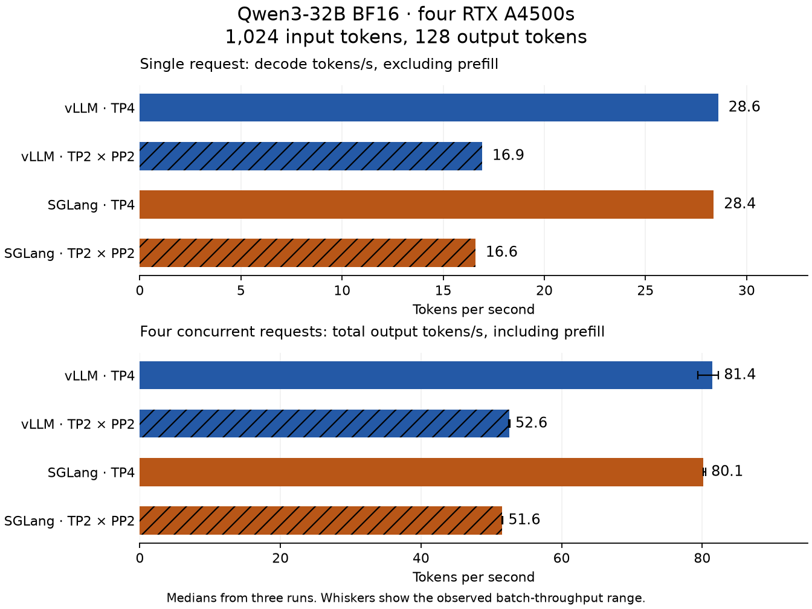

# Qwen3-32B BF16 on bly

Measured on 2026-11-13. vllm 0.33.0, PyTorch 2.14.0; sglang 0.5.23, PyTorch 2.14.1.

Model commit: `9216db5781bf21249d130ec9da846c4624c16137`. Corpus SHA256: `dff0025299d355930a1ea042245bf707f292dadc4f2e4929d25f7d4bbd152984`.

Four RTX A4500 20 GB GPUs, two NVLink pairs, PCIe between pairs. All requests run on localhost.

Each case uses one excluded warm-up batch and three measured batches. Prompts contain synthetic token IDs; each request produces exactly 128 output tokens. Prefix caching is disabled. See the accompanying README for timing definitions and limits.

| Engine/layout | Input tokens | Concurrency | TTFT ms | TPOT ms | Decode tok/s per request | Output tok/s, whole batch | Batch tok/s range |
|---|---:|---:|---:|---:|---:|---:|---:|
| sglang-tp2-pp2 | 128 | 1 | 90.0 | 60.02 | 16.66 | 16.60 | 16.58 to 16.60 |
| sglang-tp2-pp2 | 128 | 4 | 197.6 | 65.59 | 15.25 | 59.87 | 59.80 to 59.96 |
| sglang-tp2-pp2 | 1024 | 1 | 519.4 | 60.26 | 16.60 | 15.66 | 15.65 to 15.66 |
| sglang-tp2-pp2 | 1024 | 4 | 1279.2 | 67.76 | 14.76 | 51.57 | 51.54 to 51.62 |
| sglang-tp2-pp2 | 2048 | 1 | 1032.7 | 60.55 | 16.52 | 14.68 | 14.67 to 14.68 |
| sglang-tp2-pp2 | 2048 | 4 | 1843.8 | 72.58 | 13.79 | 46.20 | 46.18 to 46.23 |
| sglang-tp4-pp1 | 128 | 1 | 85.0 | 35.00 | 28.57 | 28.25 | 28.22 to 28.27 |
| sglang-tp4-pp1 | 128 | 4 | 269.7 | 36.11 | 27.69 | 105.42 | 105.38 to 105.46 |
| sglang-tp4-pp1 | 1024 | 1 | 427.9 | 35.24 | 28.37 | 26.10 | 26.10 to 26.11 |
| sglang-tp4-pp1 | 1024 | 4 | 1357.1 | 39.40 | 25.38 | 80.13 | 80.13 to 80.47 |
| sglang-tp4-pp1 | 2048 | 1 | 886.2 | 35.38 | 28.26 | 23.78 | 23.78 to 23.79 |
| sglang-tp4-pp1 | 2048 | 4 | 2324.7 | 46.45 | 21.65 | 62.26 | 62.21 to 62.27 |
| vllm-tp2-pp2 | 128 | 1 | 87.9 | 58.83 | 17.00 | 16.93 | 16.93 to 16.94 |
| vllm-tp2-pp2 | 128 | 4 | 254.5 | 61.97 | 16.14 | 63.08 | 62.19 to 63.39 |
| vllm-tp2-pp2 | 1024 | 1 | 512.2 | 59.08 | 16.92 | 15.97 | 15.97 to 15.97 |
| vllm-tp2-pp2 | 1024 | 4 | 1650.9 | 63.40 | 15.78 | 52.58 | 52.51 to 52.62 |
| vllm-tp2-pp2 | 2048 | 1 | 1032.8 | 59.40 | 16.84 | 14.92 | 14.92 to 14.93 |
| vllm-tp2-pp2 | 2048 | 4 | 2875.6 | 65.06 | 15.38 | 45.66 | 45.63 to 45.78 |
| vllm-tp4-pp1 | 128 | 1 | 78.5 | 34.65 | 28.86 | 28.57 | 28.54 to 28.60 |
| vllm-tp4-pp1 | 128 | 4 | 300.9 | 35.28 | 28.34 | 107.03 | 107.00 to 107.14 |
| vllm-tp4-pp1 | 1024 | 1 | 397.8 | 34.96 | 28.60 | 26.45 | 26.44 to 26.48 |
| vllm-tp4-pp1 | 1024 | 4 | 1449.8 | 37.50 | 26.71 | 81.43 | 79.38 to 82.29 |
| vllm-tp4-pp1 | 2048 | 1 | 816.7 | 35.18 | 28.42 | 24.22 | 24.21 to 24.22 |
| vllm-tp4-pp1 | 2048 | 4 | 2915.3 | 39.95 | 25.20 | 63.65 | 63.64 to 63.67 |

Request latency and decode columns show medians across requests. Whole-batch throughput includes prefill and is the median across the three repeats. Decode speed excludes prefill. These quantities answer different questions.

## Runtime observations

- sglang-tp2-pp2: attention backend FlashInfer, startup 349.1 s, sampled peak GPU memory {'0': 19157.0, '1': 19157.0, '2': 19331.0, '3': 19331.0} MiB, arithmetic smoke answer `4`.
- sglang-tp4-pp1: attention backend FlashInfer, startup 551.1 s, sampled peak GPU memory {'0': 19857.0, '1': 19857.0, '2': 19857.0, '3': 19857.0} MiB, arithmetic smoke answer `4`.
- vllm-tp2-pp2: attention backend FlashAttention 2, startup 878.3 s, sampled peak GPU memory {'0': 18752.0, '1': 18752.0, '2': 18808.0, '3': 18808.0} MiB, arithmetic smoke answer `4`.
- vllm-tp4-pp1: attention backend FlashAttention 2, startup 800.3 s, sampled peak GPU memory {'0': 18554.0, '1': 18554.0, '2': 18554.0, '3': 18554.0} MiB, arithmetic smoke answer `4`.

SGLang 0.5.23 automatically disables prefill CUDA graphs for pipeline parallelism in these runs. Decode graphs remain enabled. The optional breakable-prefill graph override was not measured.

Package versions are recorded in `vllm-freeze.txt` and `sglang-freeze.txt`. Each configuration has its exact command, server log, startup observation, raw streaming measurements, summary, and GPU samples. Initial startup and compilation are excluded from measured request timings. Startup depends on HDD and OS page-cache state.
