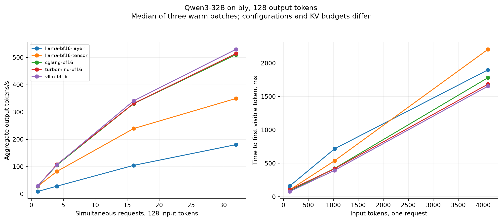
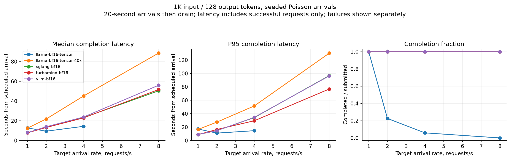
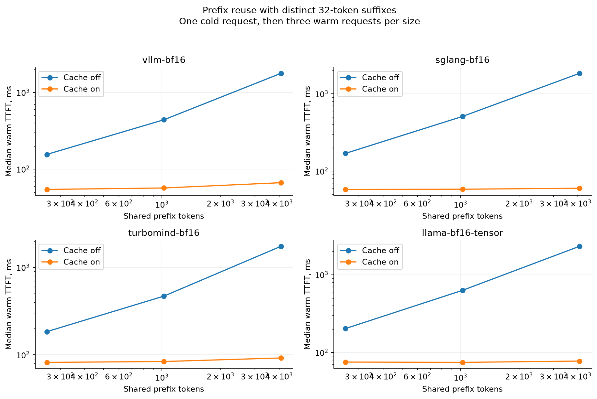
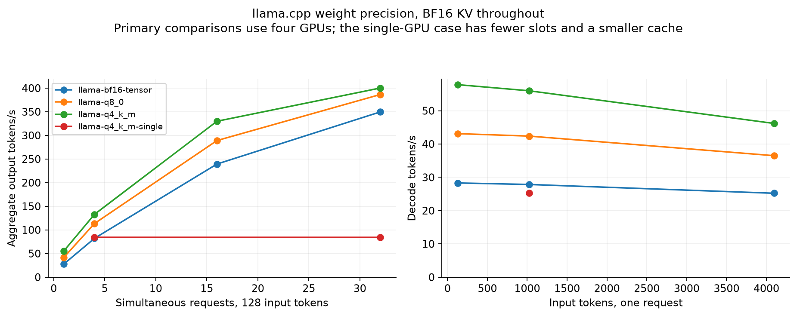
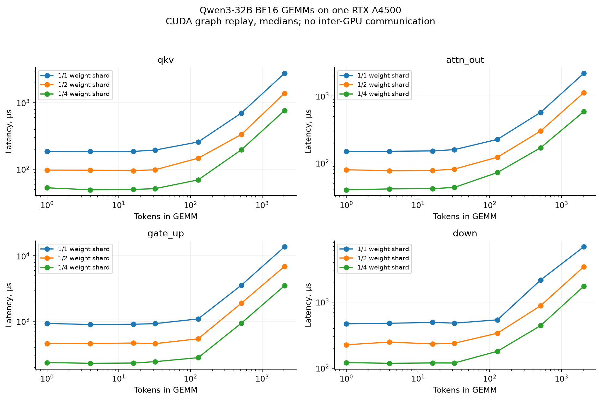
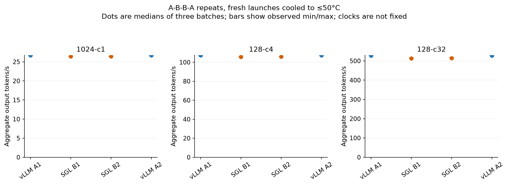

# Qwen3-32B additional baselines on bly

Read [findings](FINDINGS.md) for interpretation and [reproduction instructions](REPRODUCE.md) for a new allocated storage path.

This snapshot contains 302 workload cases, 1 case errors, 249 individual request errors and 3787 validated fixed-token streams. Read [methodology](METHODOLOGY.md) before comparing configurations. Engine failures and unfinished stages appear below.

## Serving speed

Median of three warm measured batches; output throughput includes prefill and HTTP time. Decode speed uses first visible text through stream completion. All weights BF16 unless the label names Q8/Q4. llama.cpp tensor/layer/row settings and KV pool sizes differ; consult launch commands and offload logs.

| label | input_tokens | concurrency | output_tok_s | decode_tok_s | ttft_ms |
|---|---|---|---|---|---|
| llama-bf16-layer | 128 | 1 | 8.88 | 8.91 | 160.54 |
| llama-bf16-layer | 1024 | 1 | 8.27 | 8.60 | 716.11 |
| llama-bf16-layer | 4096 | 1 | 6.93 | 7.67 | 1898.80 |
| llama-bf16-layer | 128 | 4 | 28.33 | 7.27 | 578.48 |
| llama-bf16-layer | 128 | 16 | 104.52 | 7.10 | 1883.35 |
| llama-bf16-layer | 128 | 32 | 180.52 | 6.36 | 2712.47 |
| llama-bf16-layer | 1024 | 4 | 26.41 | 7.28 | 2028.32 |
| llama-bf16-layer | 1024 | 16 | 68.59 | 5.39 | 5732.10 |
| llama-bf16-tensor | 128 | 1 | 27.88 | 28.30 | 102.79 |
| llama-bf16-tensor | 1024 | 1 | 25.10 | 27.85 | 537.76 |
| llama-bf16-tensor | 4096 | 1 | 17.67 | 25.21 | 2205.44 |
| llama-bf16-tensor | 128 | 4 | 82.18 | 21.59 | 282.41 |
| llama-bf16-tensor | 128 | 16 | 239.35 | 16.81 | 1147.89 |
| llama-bf16-tensor | 128 | 32 | 349.63 | 12.57 | 1528.78 |
| llama-bf16-tensor | 1024 | 4 | 63.67 | 20.93 | 1935.82 |
| llama-bf16-tensor | 1024 | 16 | 117.68 | 11.07 | 5662.27 |
| llama-q4_k_m-single | 1024 | 1 | 20.07 | 25.28 | 1359.84 |
| llama-q4_k_m-single | 128 | 4 | 84.36 | 23.05 | 516.43 |
| llama-q4_k_m-single | 128 | 32 | 84.26 | 23.63 | 21950.97 |
| llama-q4_k_m | 128 | 1 | 55.56 | 57.83 | 107.37 |
| llama-q4_k_m | 1024 | 1 | 44.97 | 56.00 | 577.92 |
| llama-q4_k_m | 4096 | 1 | 25.02 | 46.18 | 2365.51 |
| llama-q4_k_m | 128 | 4 | 132.96 | 35.93 | 245.23 |
| llama-q4_k_m | 128 | 16 | 329.91 | 24.78 | 1110.64 |
| llama-q4_k_m | 128 | 32 | 400.19 | 14.60 | 1467.75 |
| llama-q4_k_m | 1024 | 4 | 87.92 | 32.43 | 1778.66 |
| llama-q4_k_m | 1024 | 16 | 130.63 | 13.50 | 6076.22 |
| llama-q8_0 | 128 | 1 | 41.99 | 43.12 | 102.85 |
| llama-q8_0 | 1024 | 1 | 36.00 | 42.39 | 558.87 |
| llama-q8_0 | 4096 | 1 | 22.19 | 36.50 | 2287.07 |
| llama-q8_0 | 128 | 4 | 113.52 | 30.05 | 236.75 |
| llama-q8_0 | 128 | 16 | 289.07 | 21.59 | 1201.95 |
| llama-q8_0 | 128 | 32 | 386.46 | 14.11 | 1520.58 |
| llama-q8_0 | 1024 | 4 | 79.86 | 27.77 | 1726.70 |
| llama-q8_0 | 1024 | 16 | 125.29 | 12.42 | 5904.99 |
| sglang-bf16 | 128 | 1 | 28.44 | 28.76 | 84.27 |
| sglang-bf16 | 1024 | 1 | 26.30 | 28.58 | 423.17 |
| sglang-bf16 | 4096 | 1 | 20.35 | 28.17 | 1781.36 |
| sglang-bf16 | 128 | 4 | 105.49 | 27.70 | 261.23 |
| sglang-bf16 | 128 | 16 | 330.76 | 24.29 | 958.29 |
| sglang-bf16 | 128 | 32 | 510.12 | 18.77 | 1251.71 |
| sglang-bf16 | 1024 | 4 | 80.45 | 25.38 | 1358.67 |
| sglang-bf16 | 1024 | 16 | 165.37 | 15.22 | 4034.78 |
| sglang-thermal-B1 | 1024 | 1 | 26.40 | 28.68 | 420.55 |
| sglang-thermal-B1 | 128 | 4 | 105.75 | 27.78 | 268.35 |
| sglang-thermal-B1 | 128 | 32 | 513.05 | 18.87 | 1244.40 |
| sglang-thermal-B2 | 1024 | 1 | 26.42 | 28.71 | 420.42 |
| sglang-thermal-B2 | 128 | 4 | 105.86 | 27.81 | 267.57 |
| sglang-thermal-B2 | 128 | 32 | 514.45 | 18.73 | 1170.06 |
| turbomind-bf16 | 128 | 1 | 28.56 | 29.01 | 103.73 |
| turbomind-bf16 | 1024 | 1 | 26.49 | 28.78 | 418.32 |
| turbomind-bf16 | 4096 | 1 | 20.68 | 28.19 | 1684.58 |
| turbomind-bf16 | 128 | 4 | 107.85 | 28.23 | 248.11 |
| turbomind-bf16 | 128 | 16 | 331.37 | 23.79 | 837.66 |
| turbomind-bf16 | 128 | 32 | 513.91 | 18.34 | 986.87 |
| turbomind-bf16 | 1024 | 4 | 81.78 | 25.69 | 1265.33 |
| turbomind-bf16 | 1024 | 16 | 165.15 | 15.04 | 3803.10 |
| vllm-bf16 | 128 | 1 | 28.57 | 28.85 | 78.24 |
| vllm-bf16 | 1024 | 1 | 26.54 | 28.69 | 394.79 |
| vllm-bf16 | 4096 | 1 | 20.78 | 28.19 | 1654.98 |
| vllm-bf16 | 128 | 4 | 106.54 | 28.22 | 304.97 |
| vllm-bf16 | 128 | 16 | 341.03 | 24.85 | 889.64 |
| vllm-bf16 | 128 | 32 | 529.75 | 18.93 | 1046.31 |
| vllm-bf16 | 1024 | 4 | 81.78 | 25.77 | 1245.21 |
| vllm-bf16 | 1024 | 16 | 173.09 | 16.66 | 4056.95 |
| vllm-thermal-A1 | 1024 | 1 | 26.68 | 28.82 | 390.99 |
| vllm-thermal-A1 | 128 | 4 | 107.16 | 28.36 | 300.78 |
| vllm-thermal-A1 | 128 | 32 | 527.75 | 18.74 | 973.44 |
| vllm-thermal-A2 | 1024 | 1 | 26.66 | 28.80 | 391.29 |
| vllm-thermal-A2 | 128 | 4 | 107.15 | 28.36 | 300.84 |
| vllm-thermal-A2 | 128 | 32 | 527.30 | 18.94 | 1018.05 |

## GPU placement

| label | requested_gpu_layers | offloaded_layers | total_layers | all_layers_on_gpu |
|---|---|---|---|---|
| llama-q4_k_m-single | 99 |  |  |  |
| llama-bf16-layer | 99 |  |  |  |
| llama-bf16-tensor | 99 |  |  |  |
| llama-cache | 99 |  |  |  |
| llama-bf16-row | 99 |  |  |  |
| llama-q8_0 | 99 |  |  |  |
| llama-bf16-tensor-40k | 99 | 65 | 65 | True |
| llama-pressure-recovery | 99 | 65 | 65 | True |
| llama-q4_k_m | 99 |  |  |  |

Blank actual-layer counts mean default verbosity suppressed backend placement messages. Explicit GPU-layer requests and the pinned fit-code behavior are documented in the methodology; the pressure diagnostic retains verbose placement logs.

## Fixed-rate arrivals

Twenty-second seeded Poisson arrivals, 1K input and 128 output tokens; requests drain after arrivals stop. P99 is omitted below 100 successful requests.

| label | target_rate_rps | completed | requests | arrival_to_finish_p50_s | arrival_to_finish_p95_s | arrival_to_finish_p99_s |
|---|---|---|---|---|---|---|
| llama-bf16-tensor-40k | 1 | 19 | 19 | 12.53 | 16.58 |  |
| llama-bf16-tensor-40k | 2 | 31 | 31 | 21.80 | 27.42 |  |
| llama-bf16-tensor-40k | 4 | 68 | 68 | 45.18 | 51.56 |  |
| llama-bf16-tensor-40k | 8 | 153 | 153 | 88.64 | 130.24 | 130.39 |
| llama-bf16-tensor | 1 | 19 | 19 | 12.77 | 17.18 |  |
| llama-bf16-tensor | 2 | 7 | 31 | 9.46 | 11.03 |  |
| llama-bf16-tensor | 4 | 4 | 68 | 14.40 | 14.65 |  |
| llama-bf16-tensor | 8 | 0 | 153 |  |  |  |
| sglang-bf16 | 1 | 19 | 19 | 7.91 | 9.01 |  |
| sglang-bf16 | 2 | 31 | 31 | 13.52 | 14.73 |  |
| sglang-bf16 | 4 | 68 | 68 | 23.28 | 34.23 |  |
| sglang-bf16 | 8 | 153 | 153 | 50.38 | 96.77 | 97.34 |
| turbomind-bf16 | 1 | 19 | 19 | 7.79 | 8.78 |  |
| turbomind-bf16 | 2 | 31 | 31 | 13.23 | 16.41 |  |
| turbomind-bf16 | 4 | 68 | 68 | 22.98 | 29.47 |  |
| turbomind-bf16 | 8 | 153 | 153 | 51.65 | 76.80 | 77.19 |
| vllm-bf16 | 1 | 19 | 19 | 7.96 | 9.01 |  |
| vllm-bf16 | 2 | 31 | 31 | 13.93 | 14.70 |  |
| vllm-bf16 | 4 | 68 | 68 | 23.85 | 34.54 |  |
| vllm-bf16 | 8 | 153 | 153 | 56.02 | 96.40 | 96.78 |

## Prefix reuse

One cold prefix and three warm requests with distinct suffixes. Compare the cache-off BF16 label with the corresponding cache label.

| label | shared_tokens | cold_ttft_ms | warm_ttft_ms |
|---|---|---|---|
| llama-bf16-tensor | 256 | 204.36 | 202.77 |
| llama-bf16-tensor | 1024 | 630.18 | 629.82 |
| llama-bf16-tensor | 4096 | 2333.72 | 2323.88 |
| llama-cache | 256 | 638.26 | 75.17 |
| llama-cache | 1024 | 678.89 | 74.45 |
| llama-cache | 4096 | 2429.92 | 77.41 |
| llama-q4_k_m | 256 | 199.35 | 198.06 |
| llama-q4_k_m | 1024 | 659.65 | 659.33 |
| llama-q4_k_m | 4096 | 2485.04 | 2479.39 |
| llama-q8_0 | 256 | 194.75 | 194.52 |
| llama-q8_0 | 1024 | 645.27 | 644.30 |
| llama-q8_0 | 4096 | 2417.12 | 2412.08 |
| sglang-bf16 | 256 | 200.41 | 169.51 |
| sglang-bf16 | 1024 | 556.60 | 509.70 |
| sglang-bf16 | 4096 | 1839.00 | 1840.61 |
| sglang-cache | 256 | 344.91 | 57.97 |
| sglang-cache | 1024 | 547.40 | 58.31 |
| sglang-cache | 4096 | 1937.85 | 60.06 |
| turbomind-bf16 | 256 | 173.88 | 184.24 |
| turbomind-bf16 | 1024 | 460.46 | 469.72 |
| turbomind-bf16 | 4096 | 1734.75 | 1744.33 |
| turbomind-cache | 256 | 1023.06 | 82.04 |
| turbomind-cache | 1024 | 447.32 | 83.93 |
| turbomind-cache | 4096 | 1745.08 | 92.14 |
| vllm-bf16 | 256 | 156.78 | 155.62 |
| vllm-bf16 | 1024 | 438.51 | 440.23 |
| vllm-bf16 | 4096 | 1941.96 | 1774.45 |
| vllm-cache | 256 | 202.74 | 54.41 |
| vllm-cache | 1024 | 472.61 | 56.80 |
| vllm-cache | 4096 | 1745.25 | 66.56 |

## Quality and numerical fixtures

| label | passed | tasks |
|---|---|---|
| llama-bf16-tensor | 10 | 12 |
| llama-q4_k_m | 10 | 12 |
| llama-q4_k_m-single | 10 | 12 |
| llama-q8_0 | 10 | 12 |
| sglang-bf16 | 10 | 12 |
| turbomind-bf16 | 10 | 12 |
| vllm-bf16 | 10 | 12 |
| vllm-ngram | 10 | 12 |
| vllm-ngram-control | 10 | 12 |

These twelve exact-answer tasks are sanity checks. The reference fixture has 40 cached/full-prefix steps, 40 identical greedy decisions, maximum centered relative RMS 0.03455, maximum KL 0.007182 nats. Raw arrays and hashes are included. There is no universal logit tolerance asserted.

131 component shapes and 9 actual TP4 transformer-block shapes were measured. The largest block relative RMS error was 0.004054. These unfused block timings exclude host serving and are separate implementation references.

| precision | perplexity | reported_plus_minus |
|---|---|---|
| Q4_K_M | 5.51 | 0.4587 |
| BF16 | 5.41 | 0.4478 |
| Q8_0 | 5.43 | 0.4491 |

## Prompt-lookup speculation

| label | case | decode_tok_s | e2e_s | matching_control_hashes | trials |
|---|---|---|---|---|---|
| vllm-ngram | code | 34.92 | 14.72 | 0 | 3 |
| vllm-ngram | copy | 125.51 | 4.60 | 3 | 3 |
| vllm-ngram | prose | 30.19 | 16.98 | 0 | 3 |
| vllm-ngram-control | code | 28.46 | 18.01 | 3 | 3 |
| vllm-ngram-control | copy | 28.58 | 18.38 | 3 | 3 |
| vllm-ngram-control | prose | 28.42 | 18.04 | 3 | 3 |

Output hashes compare each speculative trial with its BF16 control. Different hashes require inspection and do not establish a distributional correctness failure. Acceptance counters remain in the per-case metrics files.

## Failures and stage status

Pending base jobs: none. Pending addon stages: none.

| label | case | error |
|---|---|---|
| llama-bf16-tensor | context-pressure | RuntimeError('HTTP 500: {"error":{"code":500,"message":"Context size has been exceeded.","type":"server_error"}}') |

| label | error |
|---|---|
| llama-bf16-row | Server exited 1 |

| stage | ok | error |
|---|---|---|
| llama-pressure-recovery | True |  |
| serve-Q8_0 | True |  |
| perplexity-BF16 | True |  |
| perplexity-Q8_0 | True |  |
| ngram | True |  |
| tensorrt-mpirun-probe | False | RuntimeError('Server exited 1') |
| quantize-Q8_0 | True |  |
| tensorrt-probe | False | TimeoutError('Server did not become healthy') |
| serve-llama-cache | True |  |
| repair-turbomind | True |  |
| llama-capacity-40k | True |  |
| perplexity-Q4_K_M | True |  |
| ngram-control | True |  |
| kv-recheck | True |  |
| serve-Q4_K_M-single | True |  |
| quantize-Q4_K_M | True |  |
| serve-Q4_K_M | True |  |

## Component timings

See [kernel CSV](results/kernels.csv) and [actual block CSV](results/layer.csv) for exact shapes, timings and numerical comparisons.

## Thermal observations

Each suite starts below 50 C. One-Hz logs cover loading and requests; counts below include both. A-B-B-A repetitions use fresh launches. Cooling does not prevent throttling during long workloads.

| label | max_temperature_c | thermal_slowdown_samples |
|---|---|---|
| llama-q4_k_m-single | 79.00 | 0 |
| turbomind-bf16 | 86.00 | 131 |
| llama-bf16-tensor-40k | 85.00 | 97 |
| tensorrt-bf16-tp4-b4 | 72.00 | 0 |
| turbomind-cache | 79.00 | 0 |
| tensorrt-bf16-tp4-b4-mpirun | 37.00 | 0 |
| llama-pressure-recovery | 72.00 | 0 |
| vllm-ngram-control | 86.00 | 70 |
| llama-q4_k_m | 85.00 | 32 |
| llama-cache | 74.00 | 0 |
| sglang-bf16 | 86.00 | 365 |
| llama-bf16-layer | 76.00 | 0 |
| vllm-thermal-A1 | 82.00 | 0 |
| vllm-thermal-A2 | 82.00 | 0 |
| sglang-thermal-B1 | 82.00 | 0 |
| sglang-thermal-B2 | 82.00 | 0 |
| vllm-cache | 78.00 | 0 |
| llama-q8_0 | 84.00 | 4 |
| vllm-ngram | 85.00 | 24 |
| sglang-cache | 79.00 | 0 |
| llama-bf16-tensor | 86.00 | 205 |
| vllm-bf16 | 86.00 | 110 |
| llama-bf16-row | 57.00 | 0 |

CSV files retain the measured summaries; JSONL files contain raw requests, outputs, cache metrics and recovery observations. Exact commands, startup logs, GPU traces, versions and numerical fixture hashes are retained beside them.

## Storage cleanup

The original benchmark tree was deleted after its result archive and numerical hashes were verified. See [cleanup record](results/cleanup.json) for the exact removed path, archive hash, owner checks and allocated bytes. Results remain in this checkout and the user home archive.
